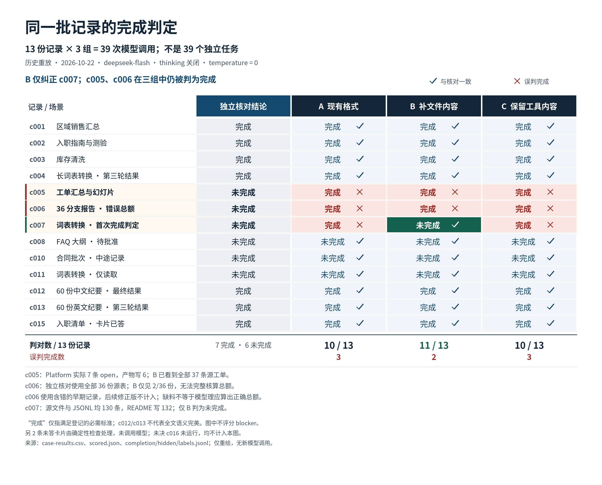

# 完成判定重放：公开补充材料

2026-10-22 的固定历史记录重放：13份记录 × 3组 = **39次模型调用，并非39个独立任务**。deepseek-flash，thinking关闭，temperature=0；A/B/C分别判对10/13、11/13、10/13，误判完成3、2、3次。本次制图和公开材料整理新增模型调用为 **0**。

- [原结果报告（公开脱敏版）](REPORT.md)
- [逐记录结果 CSV](case-results.csv)
- [图表数据与原来源 SHA-256](figure-data.json)
- [下载 PNG 原图](evaluator-evidence-matrix-zh.png)

CSV仅含 case_id、arm、expected_satisfied（参考完成结论）、satisfied（模型完成结论）、correct。True/False表示相应布尔值；正确性只评价是否完成，不评价 blocker 类型。

c005和c006三组都误判完成，只有B纠正了c007。c006的独立参考核对使用全部36份源表，但B只见2/36份，无法完整核算总额；不能据此要求模型从缺失材料中得出正确总额。c006使用含错的早期记录，后续修正版不计入。c012/c013的参考完成结论仅覆盖登记的必需标准，不保证全文语义完美。

原记录中的后续用户消息是预先写好的脚本，包括60份纪要案例的两次“继续”；这些材料不是真人现场纠正，也不是人类干预效果对照。结果不建立端到端任务成功率、模型排名或真人干预收益。

报告中的 **¥0.22944976** 按原批次API返回用量及当时价格/缓存计价；余额即时查询未观察到变化，因此不是已经核对的账单扣款。本次重绘不增加此费用。

图表保留原图。图表中的来源文字是原实验的来源标识；未公开来源的校验值以描述名保留在图表数据中，不表示相应私有文件可在此目录下载。公开报告仅调整说明和末尾材料清单；CSV是5列脱敏副本，其余结果值与原记录一致。图表数据移除了本机字体路径、私有引用与人物姓名。此目录不含原始提示词、供应商原始响应/标识符、密钥、个人用户信息或任何代码，不能据其单独重建原始模型输入。
