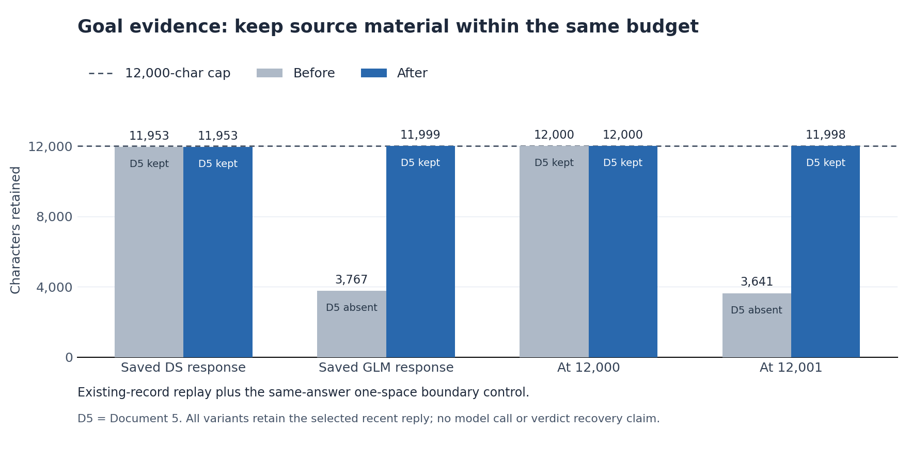
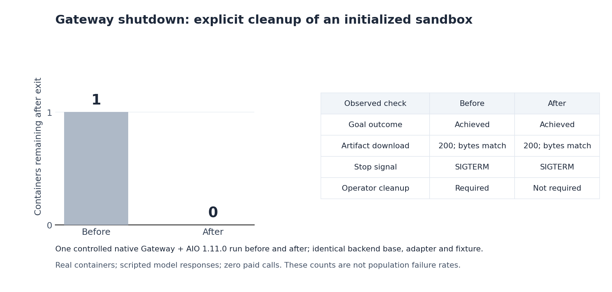
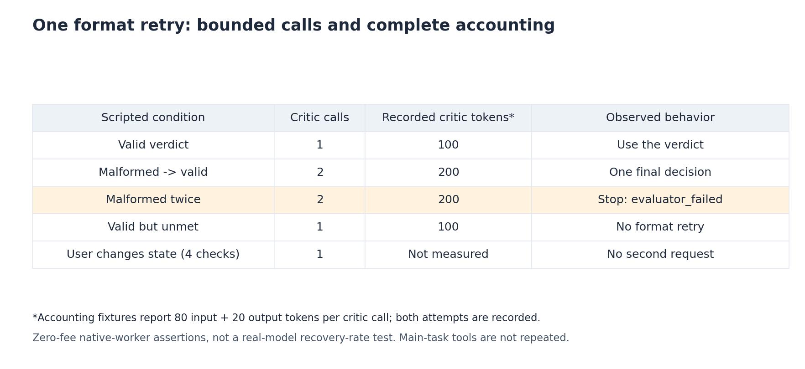

# Goal and Gateway runtime fixes: validation assets

This branch contains public figures, redacted log excerpts and machine-readable results for three runtime fixes. Plotting code, experiment code, private saved conversations and original logs are excluded. These assets are kept separate from the production-code PR commits.

The new validation described here made **zero live supplier calls** and added **CNY 0** in model cost. Saved benchmark responses were generated earlier; their original cost is outside the zero-cost replay. All values and commit attribution are available in [validation-data.json](validation-data.json).

## Goal evidence within the same 12,000-character budget

The native formatter replayed existing saved DS and GLM response records. A same-answer control differed by one internal space at the 12,000-character boundary. The cap stayed at 12,000 characters, and every variant retained the selected recent reply. The saved GLM case retained 3,767 characters before and 11,999 after; the 12,001-character control retained 3,641 before and 11,998 after. Document 5 was absent before and retained after in those two cases.

This is deterministic retained-input evidence. No new model verdict was requested, and no completion-verdict recovery or model-quality improvement is claimed. The private saved record bodies are not included.

Evidence: [failing assertion before the fix](evidence-cap-red.redacted.txt) · [263-test formatter regression after the fix](evidence-cap-green.redacted.txt).

## Real Gateway and AIO shutdown, one run per condition

One controlled native Gateway + AIO 1.11.0 run was performed before and after (**n=1 each**). Containers and file tools were real; model replies were scripted. Both runs achieved the Goal, downloaded the same 22-byte artifact with HTTP 200, and exited through ordinary SIGTERM. Owned containers remaining after exit changed from **1 to 0**. The before run required operator cleanup; the after run did not.

The fixture and adapter were identical. The before backend and the patched run's baseline backend had the same tree, `718ed58535adc1dbfcbcb125e1f62fcb0afe23fc`; the only backend implementation difference was the shutdown patch. This controlled reproduction does not estimate a production leak rate or population failure rate.

Evidence: [before shutdown excerpt](before-gateway.redacted.log) · [after shutdown excerpt](after-gateway.redacted.log).

## One format retry with complete accounting

Scripted native-worker regressions check that a normal verdict uses one critic request; malformed then valid uses two; two malformed replies stop at two with `evaluator_failed`; and a valid unmet verdict receives no format retry. Abort, clear, replace and new-message checks prevent a second request and stale verdict persistence. Explicit refusals, length stops and unknown termination outcomes are not format-retried.

The accounting fixtures report 80 input + 20 output tokens per critic request. Memory and SQLite stores record both requests separately, giving 200 critic tokens for two attempts. These synthetic token counts check accounting; **they are not real-model recovery probabilities**. The focused final regression reported 295 passed and 1 skipped.

Evidence: [accounting failures before the fix](format-retry-red.redacted.txt) · [focused final regression](focused-final-with-refusal.redacted.txt).

## Combined native run and full regression attribution

A separate controlled real Gateway + AIO run (**n=1**) at `e4c2bbd87e69567b28342b7e0db47f6e56b77805` injected one malformed scripted critic response followed by a valid one. It made three main-model and two critic requests; `write_file` and `present_files` each ran once. The ledger recorded 410 input + 110 output = 520 synthetic tokens, including both critic usages (100 + 120 = 220). Goal completion, the 22-byte download and ordinary SIGTERM cleanup passed, leaving zero owned containers.

The initial checker omitted a `ToolMessage` with `name=null`. Tool call IDs, tool declarations and persisted successful receipts from the same run corrected the count; no run or request was repeated. This short task did not exercise the long-input budget boundary.

Evidence: [combined native Gateway excerpt](joint-gateway.redacted.log) · [numeric results and provenance](validation-data.json).

The full combined offline regression belongs specifically to **`e4c2bbd87e69567b28342b7e0db47f6e56b77805`**: **35,816 passed / 806 skipped** across four non-live shards, plus **275 passed / 1 skipped** for blocking I/O. All five commands exited zero. The corrected baseline at `cc013c96808e68ca99338841dd2ba997076e826d` had 35,792 / 806 plus 275 / 1: 24 additional passing tests, with unchanged skips. Ruff, formatting, guidance-budget and diff checks passed. These counts are not attributed to a later publication or rebased commit, and they do not represent external CI or live-provider tests.

An initial baseline launch failed because bare `python` was absent from `PATH`. The corrected baseline and integration used the same pre-existing Python 3.12.13 environment first on `PATH`; dependencies and source were not changed to bypass the failure, and no test was excluded.

## Source commits

| Scope | Recorded source |
| --- | --- |
| Goal evidence | `139d0395a59fffad02c69cb8cd20024d8d497103` |
| Goal format retry | `f16d2e88847e9101430b5d1617ec85a0ac77ef4c` |
| Gateway shutdown patch | `bef1186949a0385f3ccbb73a987d5a986c162094` |
| Combined integration and full regression | `e4c2bbd87e69567b28342b7e0db47f6e56b77805` |

The combined integration contains cherry-picked equivalents of the three fixes. The standalone AIO after-run used the shutdown patch before it was committed; its recorded patch matches `bef1186949a0385f3ccbb73a987d5a986c162094`.

Log excerpts replace host paths, test identities, request IDs, ports and container/process identifiers with placeholders. Numeric results are reduced to public experiment configuration, values and commit provenance. PNG metadata contains only the plotting software label, and the figures contain no private conversation text.

## Publication-head recheck

Rebased onto upstream `main` `0d3a562c5f6d991e815603827295c60c1814efbe` without changing the fix implementation or dependencies.

- Goal head `8865d7d204914f590ba41696bcc1e460233f59f5`: [440 focused tests passed](goal-final-head-tests.redacted.log).
- Gateway head `604b385b46ad9ff606be10338e66c580884cc6d7`: [59 lifecycle/shutdown tests passed](gateway-final-head-tests.redacted.log).

The earlier full-suite totals continue to belong only to integration head `e4c2bbd87e69567b28342b7e0db47f6e56b77805`.
