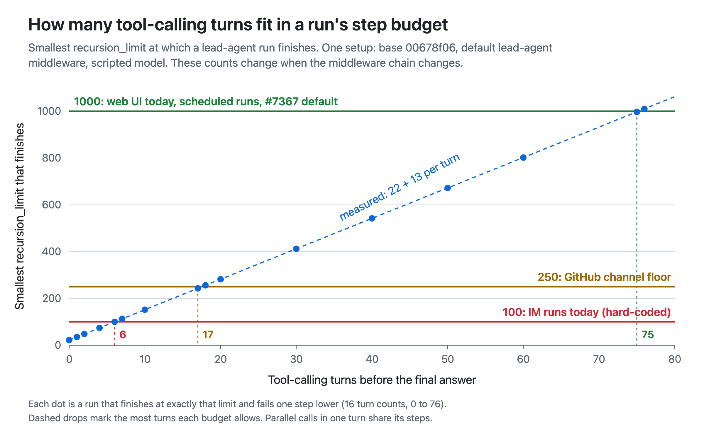

# IM step budget: measurement and chart

Chart for the IM `recursion_limit` change in bytedance/deer-flow. It shows the smallest `recursion_limit` at which a lead-agent run finishes, by the number of tool-calling turns before the answer, with three budget lines:

- 100: IM channel runs on `main`, which send a fixed value;
- 250: the GitHub channel floor;
- 1000: web UI runs today, scheduled runs, and the top-level default proposed in #7367.



## Setup

- DeerFlow base `00678f06`: the production lead agent from `_make_lead_agent`, with its default middleware chain.
- `LocalSandboxProvider`, default summarization and memory settings, and thinking, plan mode and subagents off.
- A scripted fake model takes N turns, each with one distinct `write_file` / `read_file` call, and then answers. No provider or network call.

Each point is a run that finishes at exactly that limit and fails one step lower. In this setup that is 22 plus 13 per tool-calling turn. Parallel calls in one turn share that turn's steps: 6 turns of 3 calls each still finish at 100. These counts belong to this setup: adding or removing graph middleware changes them.

## Files

| File | What it is |
| --- | --- |
| `im-step-budget.png` | The chart, rendered at 2x |
| `chart-data.json` | The measured points, the direct checks of the 100, 250 and 1000 budgets, and the parallel-call check |
| `measure_step_budget.py` | Produces `chart-data.json` |
| `make_chart.py` | Renders `chart-data.json` as SVG and an HTML wrapper |

## Reproduce

```sh
python measure_step_budget.py /path/to/deer-flow/backend --out chart-data.json
python make_chart.py .
```

Run the first command with that backend's Python environment. The PNG is the HTML wrapper captured with a headless browser at a device scale factor of 2.
