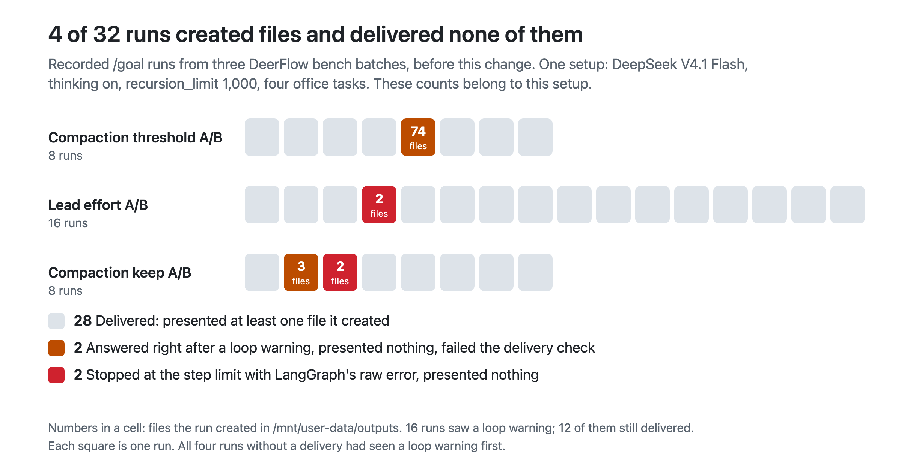

# Undelivered outputs in recorded bench runs

Chart for the run-end delivery change in bytedance/deer-flow. It classifies 32 recorded `/goal` runs from three DeerFlow bench batches by whether each run presented the files it created in `/mnt/user-data/outputs`:

- delivered: the run presented at least one file it created;
- answered right after a loop-detection warning and presented nothing, so the run failed its delivery check;
- stopped at the step limit with LangGraph's raw error and presented nothing.



## Setup

- The runs used a local Gateway before this change, with DeepSeek V4.1 Flash, thinking on, `recursion_limit` 1,000 and the default loop-detection thresholds.
- Four office tasks: slides with speaker notes, spreadsheets, an expense report and meeting minutes. The three batches compared other settings (compaction threshold, compaction keep, lead-agent reasoning effort); this chart does not compare those arms.
- The script reads each run's recorded Gateway events: the last `run.delivery` receipt (created and presented outputs), `run.error`, and `middleware:loop_detection` warnings.

These counts belong to this setup and are not a regression contract.

## Files

| File | What it is |
| --- | --- |
| `delivery-outcomes.png` | The chart, rendered at 2x |
| `chart-data.json` | One row per run: error type, loop warnings, outputs created and presented, outcome |
| `scan_bench_runs.py` | Produces `chart-data.json` from the recorded run folders |
| `make_chart.py` | Renders `chart-data.json` as SVG and an HTML wrapper |
| `step-limit-before.png`, `step-limit-after.png` | The chat page after a step-limit stop, with mocked Gateway responses: `main`'s frontend and error text, then this change's |

## Reproduce

```sh
python scan_bench_runs.py "Compaction threshold A/B=<runs dir>" "Lead effort A/B=<runs dir>" "Compaction keep A/B=<runs dir>" --out chart-data.json
python make_chart.py .
```

The run folders themselves are not published. The PNG is the HTML wrapper captured with a headless browser at a device scale factor of 2.
