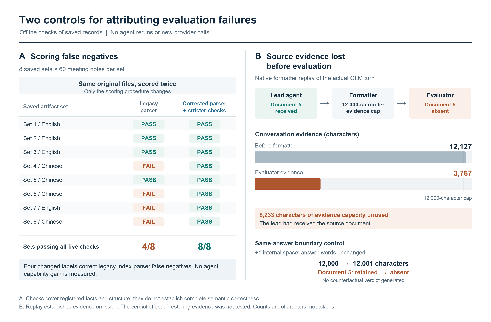

# Two attribution-control candidates

Two local cases illustrate how a scoring result or an evaluator's evidence access can be mistaken for a change in agent capability. They are candidate diagnostic controls, not an evaluation of an RSI admission policy or a measurement of human-intervention benefit.

- [Report and limitations](REPORT.md)
- [Machine-readable case data and selected source hashes](case-data.json)
- [Eight saved meeting-note output sets](minutes-regrade.csv)

The meeting-note case regrades the same eight final artifact sets: recorded and replayed completion is 4/8; a corrected parser with stricter registered checks gives 8/8. The evidence-cap case reproduces a reduction from 12,127 to 3,767 visible evidence characters; a same-answer one-space boundary control changes 12,000 to 12,001 input characters and 12,000 to 3,641 retained characters. Neither analysis makes a new provider request.

The public files contain anonymized score rows, counts, selected hashes and explicit limits. The complete 617-input meeting-note manifest remains local and can be considered separately if needed. This is a case summary, not a runnable benchmark release.
