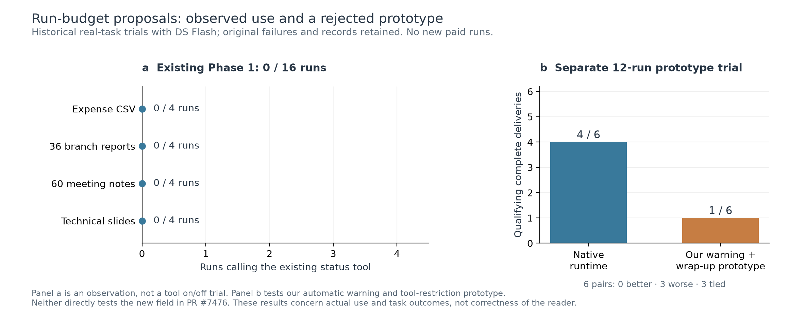

# Run-budget review evidence

Two completed real-task studies, shown separately. This material accompanies bytedance/deer-flow#7476; it is not an A/B test of the new recursion reader.

## Existing status tool: observed natural use

On the 2026-10-25 low/high study, the existing Phase 1 `inspect_run_status` tool was available in 16 normal native Goal tasks. Recounting saved tool-call events found zero calls, across four task types and four runs each:

| Task type | Runs | Runs using the status tool |
|---|---:|---:|
| Expense CSV | 4 | 0 |
| 36 branch reports | 4 | 0 |
| 60 meeting notes | 4 | 0 |
| Technical slides | 4 | 0 |

Both lead-effort settings used DeepSeek Flash with thinking enabled. These are observations of usage, not a tool-enabled/tool-disabled comparison. The Phase 2 live-recursion fields were not present.

## Separate automatic-control prototype

On 2026-10-20, three reused real-task types were run twice per arm: 12 units, six pairs. Native runtime produced 4/6 qualifying complete deliveries; our prototype produced 1/6. There were zero improved pairs, three worse pairs, and three ties.

The prototype combined automatic step warnings, forced wrap-up/tool restrictions, and one bounded artifact-presentation repair. It is a different intervention from the read-only fields in #7476. Three experimental units reached the new warning/restriction path, and all three ended with raw DSML invocation text. The warning left only one measured tool round trip before restrictions; these are concrete prototype failure modes. We did not adopt that prototype. The bounded presentation repair did not trigger, so it has no demonstrated benefit from this trial.

All failures were retained. Qualification required correct required content, valid artifact structure, normal native completion and usable delivery. Content review was source-based and unblinded, not an independent human panel. Three task types repeated twice do not represent every workload.

The earlier public investigation in [#7167](https://github.com/bytedance/deer-flow/pull/7167) also records the 4/6 versus 1/6 negative result. Its eventual Goal hard-stop fix is a separate controlled runtime reproduction, not evidence that this prototype improved task outcomes.

## Review scope

The requested change in #7476 is to omit cumulative checkpoint `step` from the model-facing response, retaining invocation `limit` and native `remaining`. These tests add practical context; they do not show that the PR reader calculates the wrong number, or establish the effect of its new fields on task success.

No production or PR source, experiment runner, plotting code, raw prompts, credentials, or personal paths are included here. The figure was generated offline from retained results; no new paid tasks were run.

