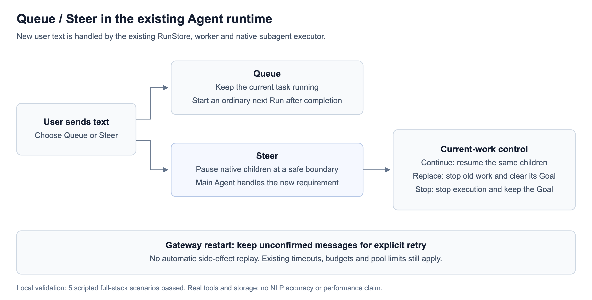
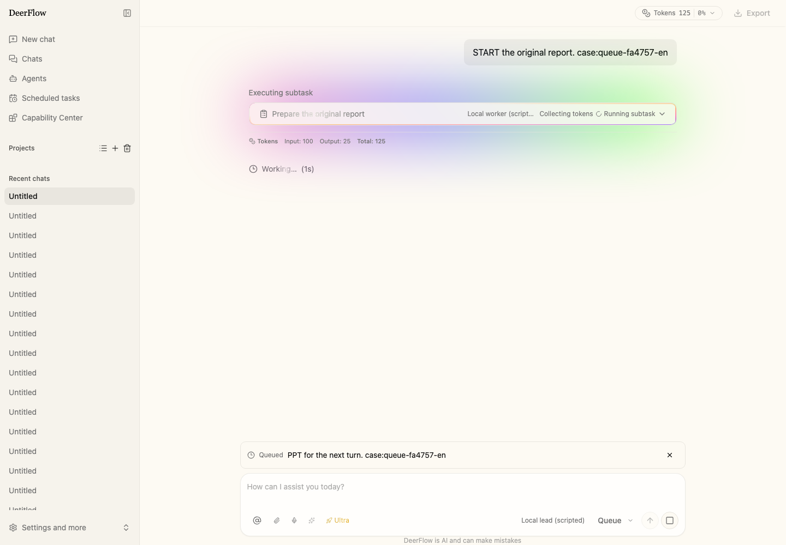
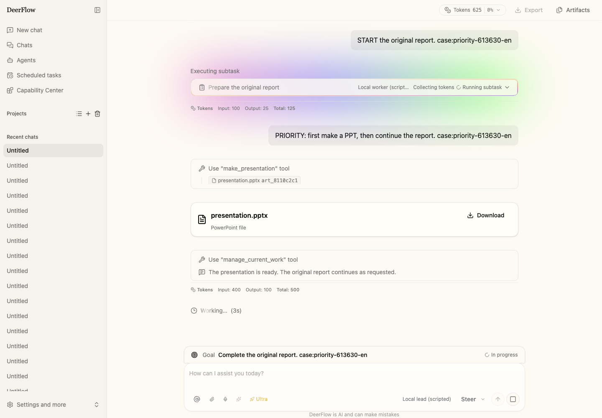
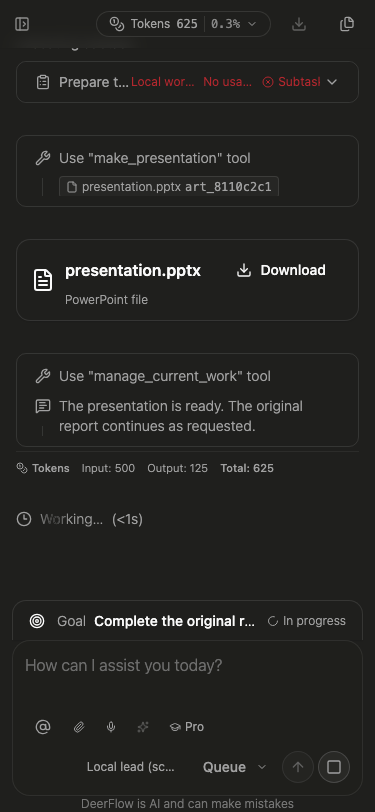
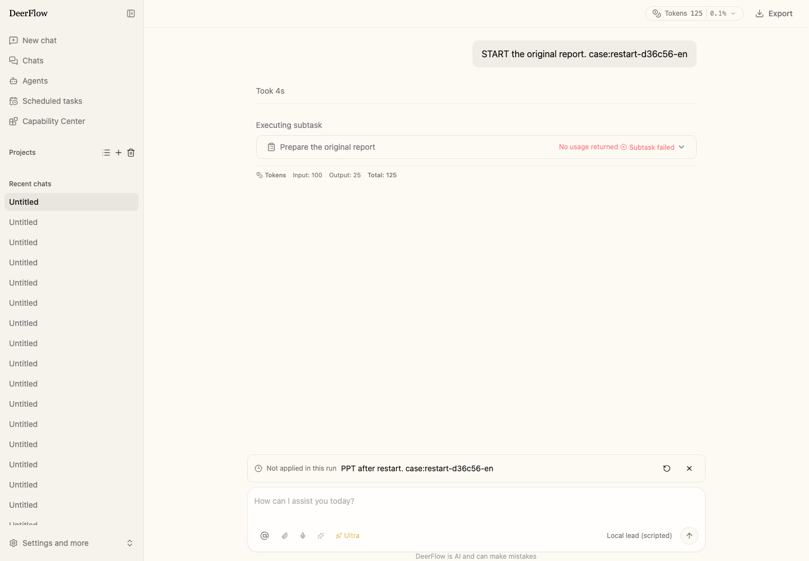
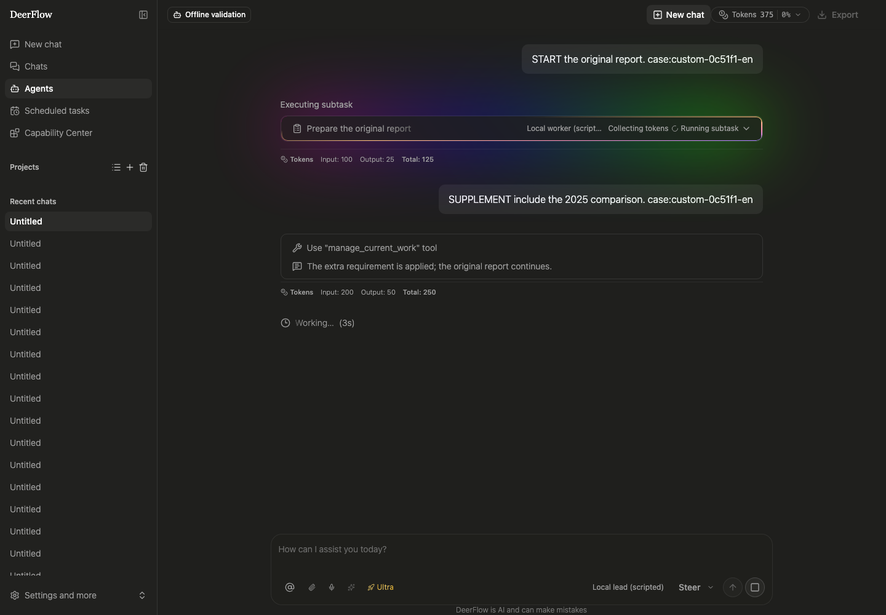

# Queue / Steer: local validation

Implementation: Totoro-qaq/deer-flow commit 3b74b5fbee3dc8020c9d214b06fe8f65636dfa33.
Base: bytedance/deer-flow `3f1438d4a0037f4518b7f0f31ab103b7f253dd19`.

This is a feature implementation and controlled integration check, not a model-quality benchmark.

## User behavior

- Queue leaves the running task unchanged and starts a normal next Run once it finishes.
- Steer delivers text to the current main Agent while a native task subagent is still running.
- A temporary priority task can finish before the same child resumes.
- Replacing the work stops old children and clears an existing Goal after authorization.
- Stopping execution keeps the Goal.
- After Gateway restart, unconfirmed messages remain available for explicit retry. Native child side effects are not replayed automatically.
- Running tool calls finish before a cooperative child pause takes effect. Existing timeouts, pool caps and budget stops still apply.

## Six full-stack page cases

The model replies were scripted through a loopback OpenAI-compatible endpoint. Gateway, worker, graph, native subagent executor, tools, SQLite, SSE and Web pages ran normally. No route or SSE interception was used, and no paid model was called.

| Case | Observed result |
| --- | --- |
| Priority PPT, then resume report, with Goal | PPT generated and presented before the original child finished; the same child then resumed; one main Run completed and the Goal ended normally |
| Queue followed by a Steer supplement | The report included the 2025 addition; queued PPT started only after report completion; the next Run kept the configured recursion limit |
| Replace old task with PPT | Old child cancelled, old Goal cleared, PPT produced; no continuation of abandoned work |
| Stop in Chinese UI | Child cancelled, Goal remained active, queued PPT did not start; unapplied text survived page reload |
| Gateway killed and restarted | Existing recovery marked the old Run error; the retained message ran only after Send again, producing one PPT |
| Custom Agent page | Supplement reached the original child, report included 2025, one main Run completed |

English/Chinese, light/dark, narrow layouts and history reconnection were checked. Browser cases used an auth-disabled loopback deployment; owner, permission and PAT boundaries were covered separately in backend regressions.

The event order for the priority case is in [execution-order.csv](execution-order.csv). These short local timings verify order only, not real-model latency.

## Checks and their scope

- Four-shard backend `make test`: **38,740 passed, 893 skipped**.
- `make test-blocking-io`: **348 passed, 1 skipped**.
- Related integrated backend regressions: **823 passed**.
- Frontend unit tests: **3,633 passed in 350 files**.
- Frontend `pnpm check`: passed.
- Changed Python lint/format and Git whitespace checks: passed.
- Guidance checks: **14 passed**.
- The final two small adjustments, sanitizing forwarded/deferred content and removing an already-applied duplicate input row, followed the full backend run. They were checked with **188 related backend tests**, all frontend unit tests, type/lint checks and all six page cases. The full backend count is from immediately before those adjustments.

Coverage includes Memory/SQLite input storage, deduplication, remove/consume races, cancellation, input during inference, late child updates, unchanged capacity bounds, budget stops, existing Teams result attribution, and database upgrade/downgrade with old Run preservation.

There were no dependency upgrades. Real PostgreSQL, external IM platforms and real-model natural-language interpretation were not tested. Existing environment-dependent skips are not counted as passes. The work does not implement child instruction-level recovery across process death.

Failure and setup-attempt records were retained locally. Raw logs, experiment code and figure-generation code are not published here.

## Images

